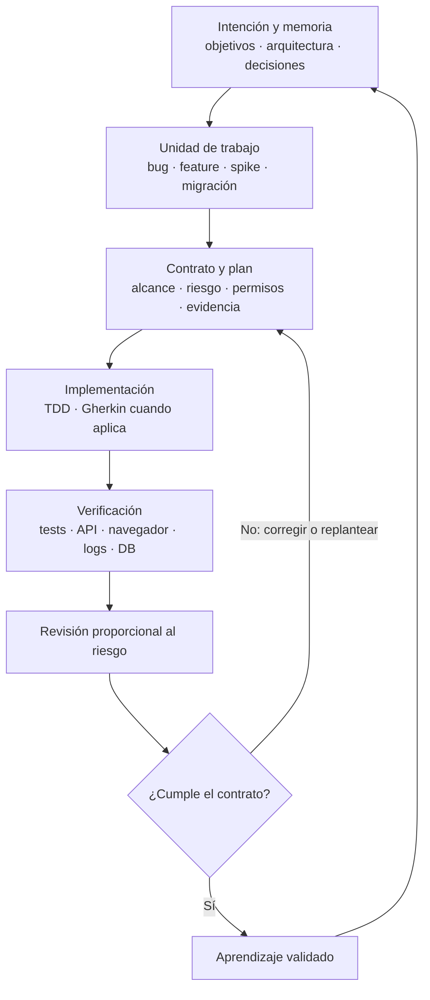
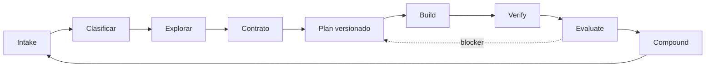
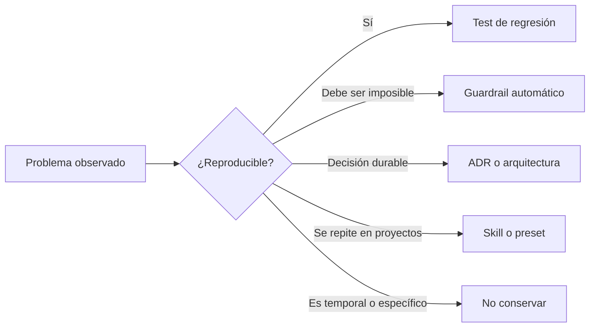

# Agentic Engineering Loop

Metodología adaptativa para desarrollar software con agentes de IA. Combina
intención explícita, contexto persistente, clasificación de riesgo, contratos,
planes versionados, TDD, Gherkin, observación real, evaluación independiente y
aprendizaje validado.

> **Regla central:** el agente no declara éxito porque el código parezca
> terminado; lo demuestra con evidencia proporcional al riesgo.

## Mapa general



## Ciclo de una unidad de trabajo



1. **Intake:** identificar si es bug, feature, refactor, migración, spike,
   incidente, performance o documentación.
2. **Clasificar:** valorar riesgo e incertidumbre.
3. **Explorar:** leer el código y documentación relevantes, ejecutar la línea
   base y observar el sistema.
4. **Contrato:** definir objetivo, límites, permisos, aceptación y evidencia.
5. **Plan:** definir los pasos necesarios y versionar el plan cuando la ruta lo
   justifique, sin convertir supuestos no comprobados en implementación detallada.
6. **Build:** implementar una unidad coherente; aislar el workspace si hay
   riesgo de interferir con otro cambio y el proyecto lo permite.
7. **Verify:** ejecutar tests y comprobaciones proporcionales al riesgo.
8. **Evaluate:** revisar contra los criterios acordados; hacerlo de forma
   independiente cuando la ruta o las reglas del proyecto lo exijan.
9. **Compound:** conservar solo aprendizajes respaldados por evidencia.

## Selección de ruta

Si todavía falta una respuesta para decidir qué construir o cómo verificarlo,
investiga primero. Con el alcance claro, elige la ruta según el impacto de equivocarte.

| Condición | Ruta | Evidencia esperada |
|---|---|---|
| Riesgo bajo, cambio claro y reversible | **Rápida** | Comprobación puntual y revisión del diff. |
| Riesgo medio y alcance verificable | **Estándar** | Criterios observables, plan breve, pruebas relevantes y revisión. |
| Riesgo alto o crítico y alcance verificable | **Seria** | Contrato aprobado, TDD, Gherkin si hay comportamiento compartido, pruebas del flujo real y revisión independiente. |
| Incertidumbre que impide decidir o verificar, con cualquier riesgo | **Investigación (`spike`)** | Pregunta, límite de tiempo, evidencia y decisión. Si el riesgo es alto o crítico, pide una decisión humana antes de pasar a implementación. |

Si aparecen riesgos o dudas nuevos, pausa el trabajo afectado y reclasifica.
Después de una investigación, vuelve a elegir ruta antes de implementar. Ninguna
ruta reduce los requisitos de aprobación o verificación del proyecto.

## Artefactos persistentes

Esta estructura es orientativa. Reutiliza los artefactos del proyecto si ya
cumplen la misma función; no dupliques contratos, planes ni registros.

```text
AGENTS.md                 → mapa corto del proyecto
.agentic/methodology.yaml → versión y adaptación de la metodología
docs/                     → arquitectura, dominio y decisiones
docs/plans/               → planes activos y completados
docs/work/contracts/      → contratos de ejecución
tests/                    → comportamiento comprobable
docs/solutions/           → aprendizajes validados
```

La unidad de paralelización no es automáticamente una feature:

> **Una unidad coherente de cambio por agente o workspace; paralelizar solo
> trabajo suficientemente independiente.**

## Técnicas dentro del ciclo

### TDD

Para lógica de negocio, APIs, permisos, migraciones y bugs reproducibles:

```text
RED → escribir test y confirmar que falla
GREEN → implementar lo mínimo y confirmar que pasa
REFACTOR → mejorar sin cambiar el comportamiento
```

### Gherkin / BDD

Para comportamiento de negocio compartido:

```gherkin
Feature: Permisos del portafolio

  Scenario: Un VIEWER intenta editar una operación
    Given un usuario con rol "VIEWER"
    When intenta actualizar una operación
    Then la API responde con estado 403
    And la operación permanece sin cambios
```

Gherkin no se usa para cada función interna; TDD y tests unitarios cubren ese
nivel con menos ceremonia.

## Política de autonomía

El contrato debe especificar qué puede hacer el agente y cuándo detenerse.
Debe pedir una decisión si:

- cambia el alcance;
- aparece una decisión de seguridad;
- faltan datos o credenciales;
- necesita acceso no autorizado;
- repite intentos sin nueva evidencia;
- debe eliminar o debilitar un test o garantía;
- excede tiempo, costo o iteraciones presupuestadas;
- el evaluador encuentra un `BLOCKER` o `HIGH`.

Las instrucciones conversacionales no sustituyen permisos reales, sandbox,
hooks, CI ni protección de ramas.

## Aprendizaje validado



Cada tres a cinco unidades de trabajo se revisa la metodología:

- ¿Qué paso detectó defectos?
- ¿Qué paso solo añadió ceremonia?
- ¿Qué regla fue ignorada o resultó innecesaria?
- ¿Qué documentación quedó obsoleta?
- ¿Qué aprendizaje debe convertirse en test o automatización?

## Relación con otras prácticas

```text
Agentic Engineering Loop
├── OpenSpec / Spec Kit → formato y flujo de especificaciones
├── TDD                 → diseño y corrección interna
├── Gherkin / BDD       → comportamiento de negocio compartido
├── Superpowers         → disciplina de ejecución y revisión
├── Compound Engineering→ aprendizaje que mejora el siguiente ciclo
└── Harness propio      → permisos, observación, límites y CI
```

No es necesario instalar todos los frameworks. La metodología selecciona la
práctica adecuada para el riesgo y la incertidumbre del trabajo.

## Cierre

Una unidad está terminada cuando se cumple:

```text
Objetivo cumplido
+ fuera de alcance respetado
+ evidencia ejecutada
+ riesgos revisados
+ evaluación independiente conforme cuando se exige
+ documentación actualizada
+ estado recuperable
```
